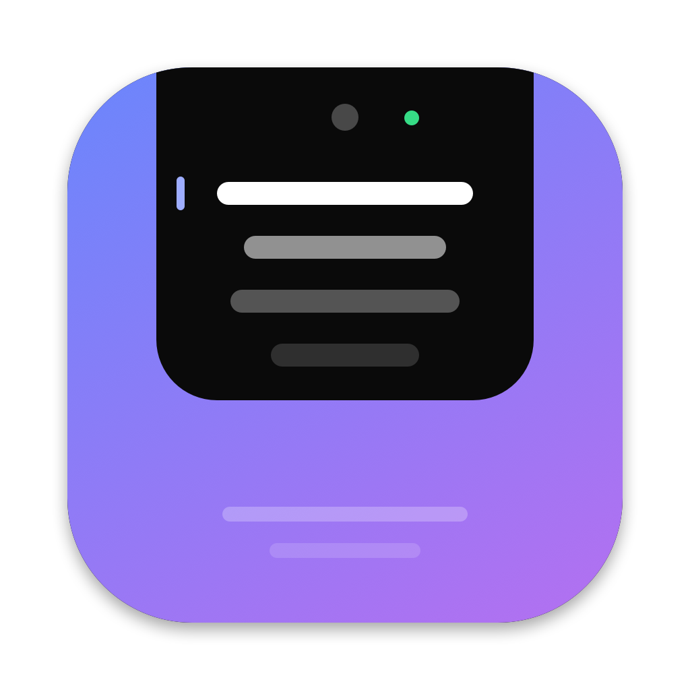

# Nibbo: a notch teleprompter for macOS

Nibbo is a small, open-source teleprompter that sits right under your MacBook's camera notch. You can read your script while still looking into the lens, on video calls, in recordings, presentations and live demos.

<p align="center">
  
</p>

<p align="center">
  <a href="https://github.com/jasonzamp/nibbo/releases/latest/download/Nibbo.zip">
    
  </a>
  <br>
  <sub>Free · macOS 13 or later · Apple Silicon and Intel · <a href="https://github.com/jasonzamp/nibbo/releases">all releases</a></sub>
</p>

## Why I built this

I'm a consultant, and a big part of my week is presenting: client meetings, workshops, demos and video calls, often back to back. I wanted to land my key points accurately without glancing at a second screen or looking down at notes, because that breaks eye contact and makes you look less sure of yourself. The teleprompters I tried were either overkill, with extra hardware or separate apps that cover the screen, or they showed up the moment I shared my screen.

So I built Nibbo, a tiny teleprompter that lives right under my MacBook's camera. My eyes stay on the lens, and the audience sees my slides while only I see my notes. I built it with Claude Code, partly to find out how far AI coding tools can take an idea, from a rough concept to a working native app.

## Features

- **Notch-docked panel.** A black panel that blends into the camera housing. Drag it anywhere, and it snaps back when you drag it near the top centre.
- **Hidden from screen sharing (best effort).** The window is marked `sharingType = .none`, so most capture tools leave it out. See the caveats below.
- **Voice mode.** It scrolls while you talk and pauses when you stop. Detection uses only the microphone volume level, and audio is never recorded or stored.
- **Global shortcuts.** They work while Zoom, Teams, Meet or OBS is the active app, and they need no Accessibility permission.
- **Never steals focus.** Clicking the prompter doesn't take focus from your meeting app.
- **Adjustable.** You can change the speed, text size, font, width and height. Resize the panel from its edges or with the sliders.
- **Script history.** Every script you write is saved locally in a history list, and you can reopen or delete any of them.
- **Click to jump.** Click a paragraph in the editor and the prompter jumps there. The paragraph you're reading stays highlighted.
- **Menu-bar app.** It has no Dock icon, and your script and settings are saved automatically.

## Shortcuts

| Keys | Action |
|---|---|
| ⌃⌥Space | Play / pause |
| ⌃⌥↑ / ⌃⌥↓ | Faster / slower |
| ⌃⌥← | Jump back a few lines |
| ⌃⌥R | Restart |
| ⌃⌥M | Voice mode on/off |
| ⌃⌥H | Hide / show the prompter |
| ⌃⌥E | Open the script editor |

Mouse: click the text to play or pause, scroll to move manually, and hover to show the controls.

## Install

Nibbo runs on Macs only (macOS 13 Ventura or later). It doesn't run on Windows or Linux.

1. **Download** [Nibbo.zip](https://github.com/jasonzamp/nibbo/releases/latest/download/Nibbo.zip) and double-click it to unzip.
2. **Drag `Nibbo.app` into your Applications folder.**
3. **Open it the first time.** Nibbo isn't signed with a paid Apple Developer ID, so macOS blocks the first launch:
   - **macOS 15 Sequoia or later:** double-click Nibbo and click **Done** on the warning. Then open **System Settings → Privacy & Security**, scroll down to *"Nibbo" was blocked…*, click **Open Anyway** and confirm.
   - **macOS 13–14:** right-click (or Control-click) Nibbo → **Open** → **Open**.

   You only need to do this once.
4. **Look at the top of your screen.** Nibbo lives in the menu bar (there's no Dock icon), and the prompter appears under the camera. The Script & Settings window opens on first launch so you can paste your script.
5. **Voice mode (optional).** The first time you turn it on, macOS asks for microphone access. Nibbo only measures how loud the room is, and audio is never recorded or sent anywhere.

Prefer the Terminal? After moving it to Applications, this clears the download flag instead of step 3:

```bash
xattr -dr com.apple.quarantine /Applications/Nibbo.app
```

**Want it on your Desktop or Dock?** Drag Nibbo from Applications onto the Dock, or hold ⌥⌘ while dragging it to the Desktop to make an alias. To start it at login, add it under System Settings → General → Login Items.

**Uninstall:** quit Nibbo (✕ on the prompter, or menu bar icon → Quit), then move `Nibbo.app` to the Bin. Your script and settings are kept in `~/Library/Preferences/io.github.jasonzamp.nibbo.plist`, so delete that file too if you want them gone.

## Build from source

You need macOS 13 or later and the Xcode Command Line Tools (`xcode-select --install`).

```bash
git clone https://github.com/jasonzamp/nibbo.git
cd nibbo
./build.sh          # builds a universal Nibbo.app (Apple Silicon + Intel)
open Nibbo.app
```

`./build.sh --zip` also packages `dist/Nibbo.zip`, the file attached to each GitHub release. The app icon is drawn in code: `swift scripts/make-icon.swift` regenerates `Resources/AppIcon.icns`.

## How it works

| File | What it does |
|---|---|
| `PrompterPanel.swift` | A borderless, non-activating `NSPanel` placed above the menu-bar level. It overrides `constrainFrameRect` so it can sit over the notch, and handles snapping and dragging. |
| `PrompterView.swift` | The SwiftUI text layer. It uses a 60 fps offset scroll, a fade mask, and a reading line at 28% of the panel height. |
| `PrompterState.swift` | Holds the script, settings and scroll engine. Settings persist in `UserDefaults`. |
| `VoiceActivityDetector.swift` | Reads RMS loudness from an `AVAudioEngine` input tap, with a 0.6 s hold so short gaps between words don't stop the scroll. |
| `HotKeys.swift` | Registers the global shortcuts with Carbon's `RegisterEventHotKey`. |
| `EditorView.swift` | The script editor and settings window. |

## Only you see your script

Your audience sees your slides, and you see your notes. The prompter window is excluded from capture with `NSWindow.sharingType = .none`. The aim is for it to stay out of:

- screen sharing in Zoom, Teams, Google Meet, Slack huddles and similar apps
- screen recordings (QuickTime, ⌘⇧5, OBS)
- screenshots (⌘⇧3 / ⌘⇧4)

The panel also floats over full-screen Keynote and PowerPoint, so you can present full screen with your script under the camera.

**Honest caveat:** macOS decides what each capture tool can see, and some newer capture paths have been reported to ignore `sharingType`. Check it with the tools you actually use before you rely on it in a real meeting. Use the checklist below.

### Privacy test checklist

- [ ] ⌘⇧3 full-screen screenshot: the prompter shouldn't appear
- [ ] ⌘⇧5 screen recording: the prompter shouldn't appear
- [ ] Zoom, sharing the entire screen (check from a second device)
- [ ] Teams, sharing the entire screen
- [ ] Google Meet in the browser, sharing the entire screen
- [ ] Sharing a single window or tab (this should always be safe, because the prompter isn't part of that window)

Safest setup for presentations: share **only the slides window** rather than your whole screen. Then the prompter can't appear however the capture tool behaves.

## Other caveats

- When the panel is wider than the notch, it covers part of the menu bar. Press ⌃⌥H to hide it.

## Roadmap

- [ ] iPhone remote: a local web page on your Wi-Fi to play, pause and change speed from your phone
- [ ] Speech-recognition tracking, so the text follows the exact words you're saying
- [ ] Markdown support (bold cues, `[PAUSE]` markers)
- [ ] Countdown before starting
- [ ] Mirror mode for beam-splitter teleprompter glass
- [ ] Signed and notarised release download

## License

MIT
